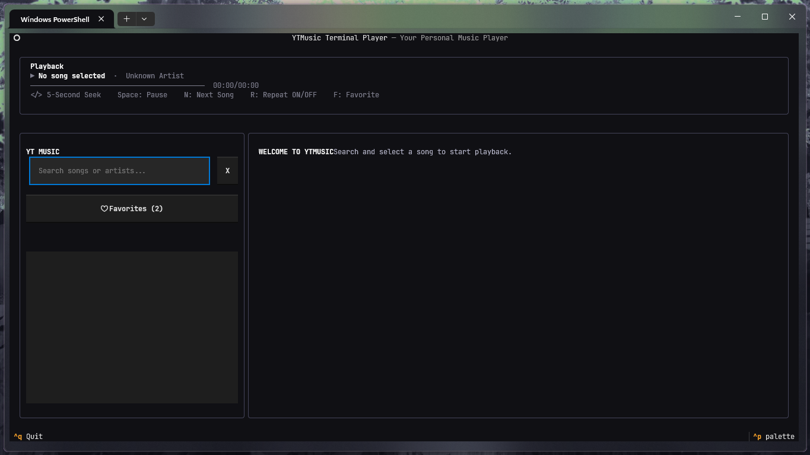
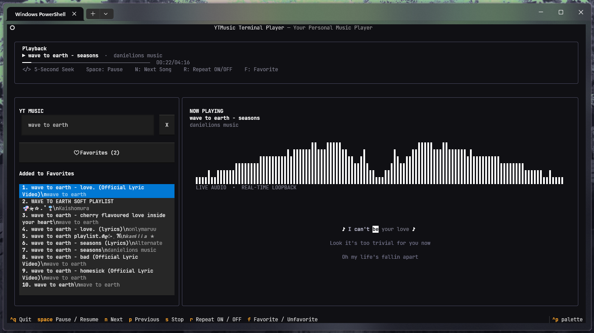
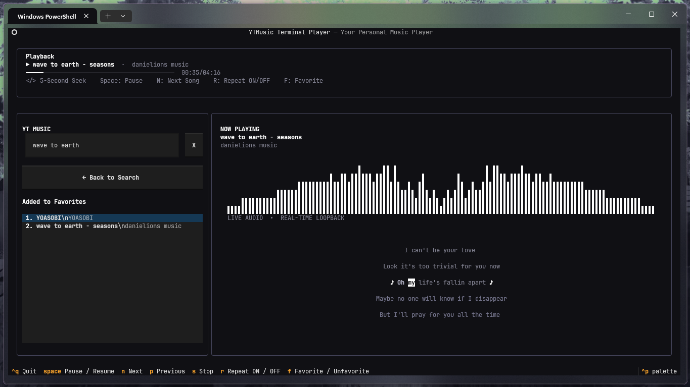
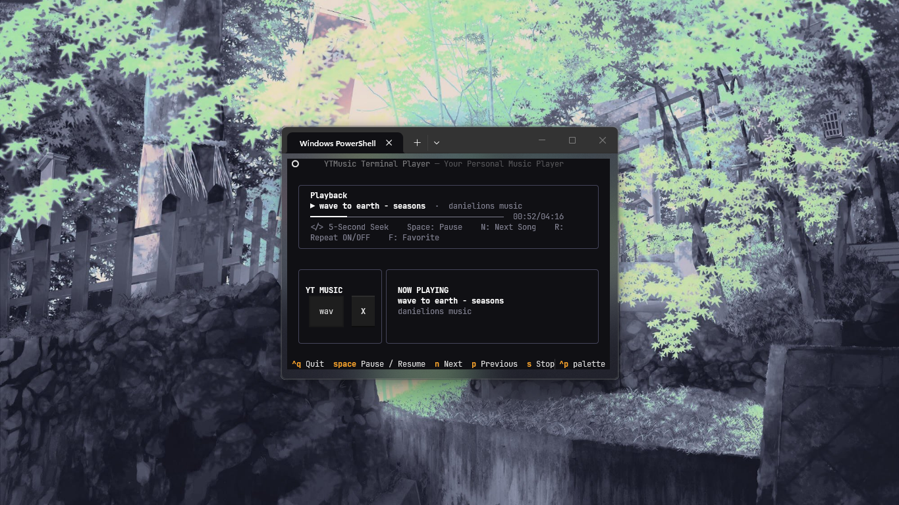
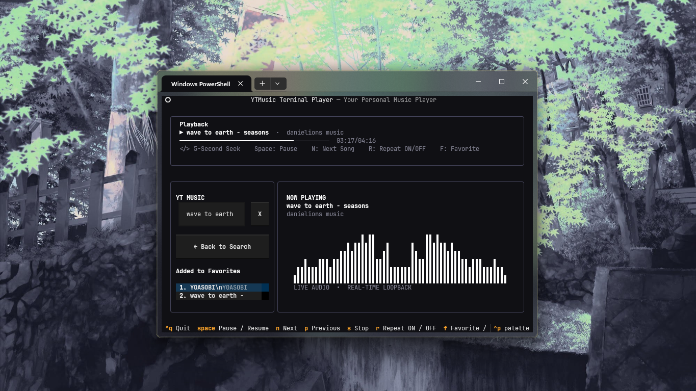

<!-- ==================== HEADER SECTION ==================== -->

<h1 align="center">Terminal UI Player</h1>

  🎧 A Python-based terminal music player with a minimalist monochrome interface.

  What started as a simple terminal-based music player has gradually evolved into something much more.
    
  It now features a clean monochrome terminal interface, integrated music search and playback, a centered lyrics display, and a persistent Favorites system.
    
  You can press <b>F</b> to add a song to Favorites, then press it again to remove it.
    
  I'm happy with how the project turned out. After experimenting with different layouts, designs, and features, It's satisfying to see an idea gradually become something this good.

## 🌟 Preview Gallery

  

  

  

  

  

<h1 align="center">Terminal UI Player Update!</h1>

  What started as a simple terminal-based music player has gradually evolved into something much more.
    
  Another step forward in making the terminal music experience better. Added new visual elements and improved playback features while keeping the original functionality intact.
    

## 🌟 Preview Gallery
